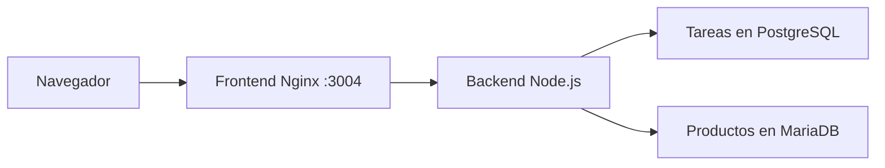

# Taller de operaciones · Reto 4

**Integrantes: Sebastián y Santiago.**

Automatización con Make y Docker Compose que coordina cuatro servicios: PostgreSQL, MariaDB, backend y frontend. Incluye una interfaz adaptable para gestionar productos en MariaDB y tareas en PostgreSQL, pruebas automáticas, sembrado idempotente y respaldos SQL verificables.

## Inicio rápido

Necesitas Docker con Docker Compose. En Windows o macOS, abre Docker Desktop; en Windows usa contenedores Linux. No es necesario instalar Node.js, Nginx ni las bases de datos.

1. Descarga el ZIP del repositorio y descomprímelo, o clónalo con Git.
2. Abre una terminal dentro de la carpeta que contiene `compose.yaml`.
3. Ejecuta:

```sh
docker compose up --build -d --wait
```

4. Abre [http://localhost:3004](http://localhost:3004).

La primera ejecución requiere internet para descargar las imágenes y dependencias. No necesitas editar `.env`. Cada integrante utiliza una copia y bases de datos independientes en su computador. Los puertos 3014 y 3027 de los otros retos quedan disponibles.

## Automatización con Make

Con GNU Make instalado, `make` muestra la ayuda y `make iniciar` construye e inicia el entorno. En Windows puedes usar WSL con la integración de Docker Desktop; también se incluyen alternativas sin Make en [la guía de Windows](docs/WINDOWS.md).

Los comandos completos de pruebas, sembrado y respaldo se describen en [el manual de operación](docs/OPERACION.md).

## Cuatro servicios reales

| Servicio | Función | Acceso |
| --- | --- | --- |
| `frontend` | Nginx sirve la interfaz y comunica `/api/` con el backend | `http://localhost:3004` |
| `backend` | API Node.js 22 con validación y consultas parametrizadas | Red interna, puerto 3000 |
| `postgres` | Almacena las tareas | Red interna, puerto 5432 |
| `mariadb` | Almacena los productos | Red interna, puerto 3306 |

Solo el frontend publica un puerto, limitado al equipo local. Las bases usan volúmenes independientes y Compose espera sus comprobaciones de salud antes de iniciar los servicios dependientes. La pantalla consulta el estado real del frontend, backend y ambos motores.



## Uso de la interfaz

- En el catálogo, crea un producto con código único, nombre y existencias. Puedes editar el nombre y las existencias y confirmar su eliminación.
- En las tareas, crea una actividad, márcala como completada o elimínala con confirmación.
- Los formularios muestran validación y conservan los datos si una operación falla.
- Las acciones usan Fetch y actualizan la pantalla sin recargarla.
- La guía de comandos de la pantalla sirve de referencia: las operaciones de Docker se ejecutan desde la terminal.

Los productos admiten códigos de 2 a 32 letras mayúsculas, números o guiones, nombres de 2 a 100 caracteres y existencias enteras de 0 a 1000000. Los títulos de las tareas admiten entre 2 y 160 caracteres.

## Datos y configuración

`docker compose down` detiene el entorno y conserva los datos. Para cambiar el puerto, crea `.env` con `APP_PORT=3104` y vuelve a iniciar; abre entonces `http://localhost:3104`.

`.env.example` contiene valores de demostración local. Los cambios de credenciales no modifican las contraseñas de un volumen ya creado. Los archivos `.env` y los respaldos se excluyen de Git.

El sembrado utiliza claves de ejemplo estables y conserva las modificaciones de los registros existentes. Puede repetirse sin duplicar los ejemplos. Los respaldos son archivos SQL nativos de los dos motores; la verificación los importa en bases temporales y compara su contenido sin reemplazar los datos de la aplicación.

## API

| Método | Ruta | Uso |
| --- | --- | --- |
| GET | `/api/health` | Comprueba ambas bases; 200 o 503 con estado por servicio |
| GET, POST | `/api/products` | Listar o crear productos en MariaDB |
| PATCH, DELETE | `/api/products/:id` | Actualizar o eliminar un producto |
| GET, POST | `/api/tasks` | Listar o crear tareas en PostgreSQL |
| PATCH, DELETE | `/api/tasks/:id` | Cambiar el estado o eliminar una tarea |

La API devuelve JSON y mensajes de error en español. Valida tipos, tamaños y límites en el servidor y usa consultas parametrizadas. El frontend inserta el contenido recibido como texto.

## Entregables y evidencia

| Requisito del reto | Entregable |
| --- | --- |
| Automatización funcional | `compose.yaml`, Dockerfiles y `scripts/` |
| Interfaz web integrada y adaptable | `frontend/` y `backend/` con datos reales en ambos motores |
| Makefile avanzado | Inicio, pruebas, sembrado, respaldo, verificación y operación del entorno |
| README con pruebas | Este documento y [capturas y registros](docs/EVIDENCIAS.md) |
| Esquema y datos iniciales | `db/postgres/` y `db/mariadb/` |
| Manual y guion de presentación | [docs/ENTREGA.md](docs/ENTREGA.md) |
| Pruebas automáticas en GitHub | `.github/workflows/verificacion.yml` |

Verificación realizada: **30 pruebas aprobadas**, sembrado repetido sin duplicados, respaldo y restauración temporal de ambos motores, integridad del SQL y persistencia tras recrear los contenedores. La interfaz real pasó revisión en escritorio y móvil. Consulta [capturas y resultados completos](docs/EVIDENCIAS.md).

## Si algo no inicia

1. Comprueba que Docker responda con `docker info`.
2. Ejecuta `docker compose ps` y `docker compose logs --tail=100`.
3. Si el puerto 3004 está ocupado, cambia `APP_PORT` como se explicó arriba.
4. Si un motor no está disponible, revisa su estado y vuelve a iniciar con el comando de inicio.

No uses `docker compose down -v` para una parada normal: elimina los volúmenes y sus datos. Para conservarlos, utiliza `docker compose down`.
