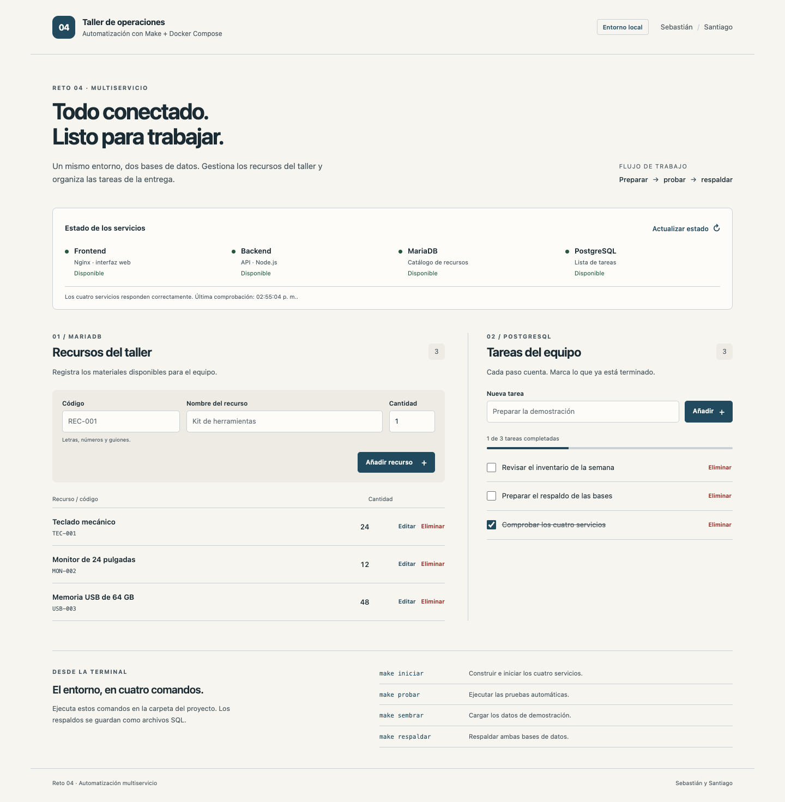
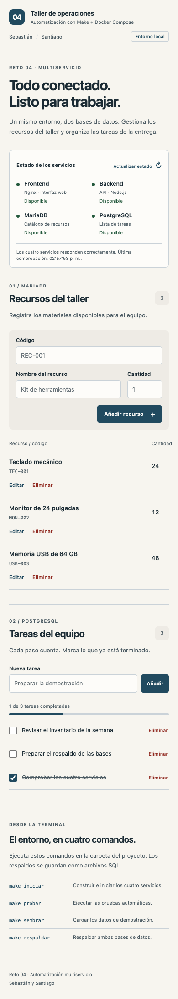
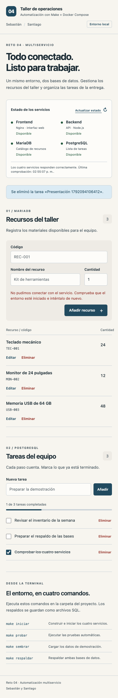

# Evidencias del reto 4

**Integrantes: Sebastián y Santiago.**

Verificación realizada el **15 de octubre de 2026** con el entorno Docker completo. PostgreSQL, MariaDB, backend y frontend se ejecutaron en contenedores separados. Las pruebas locales se realizaron en macOS; el flujo de GitHub verifica el proyecto en Linux.

## Resultados

| Verificación | Resultado |
| --- | --- |
| Arranque desde Make | Cuatro servicios saludables y frontend en `http://localhost:3004` |
| Pruebas HTTP con ambas bases reales | 30 aprobadas, 0 fallos, 0 omitidas |
| Sembrado repetido | No duplica ejemplos; conserva cambios y registros del usuario |
| Secuencia `make -j8` | Sembrado, respaldo y verificación ejecutados en orden |
| Respaldos SQL | Ambos motores generan SQL no vacío, manifiesto y huellas SHA-256 |
| Restauración temporal | Conteos y huellas de los datos restaurados coinciden |
| Datos especiales en respaldo | Comillas, Unicode y saltos de línea recuperados correctamente |
| SQL alterado | Rechazado por su huella antes de modificar las bases de la aplicación |
| Restauración sin autorización | Rechazada si falta `RESTAURAR=SI` |
| Persistencia | Datos conservados tras eliminar y recrear los cuatro contenedores |
| Interfaz real | Productos y tareas operativos mediante Fetch, sin recarga |
| Validación y conexión | Errores visibles; datos del formulario conservados ante fallo de red |
| Móvil y teclado | 390 px sin desbordamiento, etiquetas y foco comprobados |
| Accesibilidad automática | 0 incidencias en la revisión con reglas WCAG A y AA |
| JavaScript | Sin errores de ejecución en los flujos revisados |

## Repetir la comprobación

```sh
make iniciar
make probar
make sembrar
make sembrar
make respaldar
make verificar-respaldo
```

Para comprobar el orden de los objetivos con ejecución paralela solicitada:

```sh
make -j8 sembrar respaldar verificar-respaldo
```

Los respaldos se restauraron en bases temporales y se cotejaron con el manifiesto del contenido original. La prueba incluyó un producto y una tarea temporales con texto especial, además de los ejemplos. Los registros temporales se retiraron y los ejemplos modificados se devolvieron a su estado original.

## Registros completos

- [30 pruebas HTTP y base de datos](evidencias/pruebas.txt).
- [Comprobaciones de la interfaz con datos reales](evidencias/interfaz.txt).
- [Sembrado, respaldo, integridad y persistencia](evidencias/automatizacion.txt).
- [Salida de Make y restauración temporal](evidencias/respaldo.txt).

Las evidencias describen las verificaciones realizadas. Las instrucciones de Windows incluyen PowerShell, Git Bash y WSL; esta entrega no afirma una ejecución local de pruebas en Windows.

## Capturas

### Escritorio y cuatro servicios



### Vista móvil



### Conservación del formulario ante un fallo de conexión


